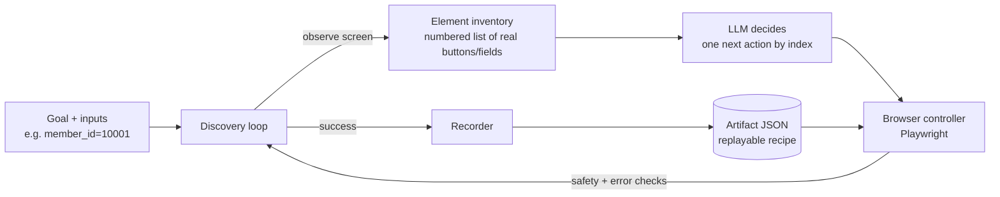

# AI Banking Computer-Use Agent

**An AI agent that learns how to use an old banking system the way a person would, by looking at the screen and clicking through it, and then saves what it learned as a safe, repeatable "recipe" that can run again without the AI.**

---

## In plain English

Many banks still run their day-to-day work on old internal software. It has no modern API, so the only way to get anything done is for a staff member to click through screens by hand: search for a member, open their accounts, read a balance, fill in a form.

This project teaches an AI to do that work:

1. **It explores.** Given a goal like *"find this member's savings balance"*, the AI looks at the screen, decides what to click or type next, and keeps going until it reaches the answer.
2. **It writes down what worked.** The successful path is saved as an **artifact**: a structured, human-readable recipe of the exact steps, what each screen should look like, and what to pull out at the end.
3. **It runs the recipe safely.** The recipe can be replayed reliably without asking the AI again. Built-in guardrails stop it from doing anything risky, like opening a new account, unless a human approves it.

**Why it matters:** this is the same idea behind "computer-use" AI assistants, applied to a setting where mistakes cost real money. The focus is on reliability, safety and auditability, not just getting a demo to work once.

---

## What it can do today

| Capability | What it means |
|---|---|
| 🔍 **AI discovery** | An LLM explores the banking app step by step and figures out a workflow (e.g. looking up a balance) without hand-written instructions |
| 📜 **Replayable artifacts** | Every workflow is saved as validated JSON: inputs, steps, checkpoints, outputs and safety rules |
| 🛡️ **Safety gate** | Risky actions such as submitting forms are blocked until a human confirms. The agent is limited to approved websites and actions |
| 🙋 **Human handoff** | Automation can pause mid-task so a person can take over in the *same* live browser session, then resume |
| ⚠️ **Smart error handling** | Tells apart "member not found" (a valid answer), "session expired" (retry it) and "something broke" (stop) |
| 🔒 **Privacy** | SSNs, emails, phone numbers and fields marked sensitive are redacted from logs and evidence |

---

## How it works



- **The AI never invents selectors.** Each turn it gets a numbered list of the elements actually on the page and picks one by number. The code then uses a real, verified locator for that element. This prevents a whole class of hallucinated-click failures.
- **Every step is checked.** Before moving on, the controller confirms the page is in the expected state rather than clicking and hoping.
- **Outputs are made reusable.** A value like `$5,230.45` only works for one member, so the system instead records *"the cell in the same table row as the label 'Savings'"*. That locator works for every member.

---

## Technical highlights

- **Artifact schema (`src/artifact/schema.py`):** Pydantic models defining a workflow like a typed function: `inputs`, ordered `steps`, `outputs`, `success_condition`, `safety_policy` and versioned `metadata`.
- **Multi-strategy locators with fallback chains:** CSS → XPath → visible text → accessibility role → screen coordinates. This matters for legacy UIs with no IDs or test hooks.
- **Frame-aware browser control (`src/browser/`):** the target app uses a real HTML `<frameset>`, so URL checks, element lookup and screenshots work across all frames, not just the top page.
- **Three-tier error taxonomy:**
  - `business_outcome`: a valid result such as *member not found*, returned as data and never raised
  - `recoverable`: e.g. *session expired*; runs a recovery action such as `navigate_home_and_retry`, then re-checks
  - `hard_failure`: stops immediately with a screenshot attached
- **Safety policy enforced on every step:** allowed domains → allowed action types → risk level vs. `max_unconfirmed_risk` → human confirmation for `submit`/`confirm`.
- **Discovery loop (`src/discovery/loop.py`) with explicit stop conditions:** done, stuck (escalate to a human), a risky action that needs approval, 3 consecutive failures (dead end), or the max step budget.
- **LLM client:** Gemini through its OpenAI-compatible endpoint, strict JSON responses, and exponential backoff for rate limits.
- **Testing:** offline unit tests for the discovery loop and recorder that need no browser or API key, plus live end-to-end tests against the real app.

**Stack:** Python · Playwright · Pydantic · Flask · Gemini (OpenAI-compatible API)

---

## The test environment: a mock legacy bank

`target-app/` is a deliberately old-fashioned Flask app that simulates a bank's back-office system. It uses table layouts, `<font>` tags, framesets and no test IDs: the kind of software these agents meet in the real world. It also has built-in edge cases:

| Member ID | Behaviour |
|---|---|
| `10001`, `10002` | Normal members with accounts |
| `00000` (any unknown ID) | "No Member Found" (business outcome) |
| `99999` | Session expired (recoverable) |
| `88888` | Permission denied |
| random ~10% of searches | Slow page load |

Member `10003` has a frozen account, which blocks viewing accounts and opening a sub-account.

---

## Run it locally

```bash
pip install -r requirements.txt python-dotenv pytest
python -m playwright install chromium

# terminal 1: start the mock bank
python target-app/app.py            # http://localhost:5000

# terminal 2: run a demo
python demo_lookup_balance.py       # replay a balance-lookup artifact
python demo_open_subaccount.py      # safety gate: blocked, then human-approved
python demo_human_handoff.py        # pause → human takes over → resume
```

To run live AI discovery, put a Gemini API key in a `.env` file (this file is git-ignored):

```
GEMINI_API_KEY=your_key_here
```

```bash
python test_discovery_live.py       # the AI discovers the balance-lookup flow on its own
python test_output_locator_live.py  # the AI finds a reusable locator for the output value
```

Offline tests (no browser or API key needed):

```bash
python -m pytest src/discovery/
```

---

## Project structure

```
├── target-app/               Mock legacy banking app (Flask + HTML templates)
├── src/
│   ├── artifact/schema.py    The artifact "contract": Pydantic models
│   ├── browser/              Playwright controller, locators, checkpoints, errors, observation/PII redaction
│   ├── discovery/            LLM discovery loop, element/value inventories, recorder, output locator
│   └── replay/               Replay engine (planned)
├── evidence/
│   ├── artifacts/            Example artifacts, including one discovered entirely by the AI
│   └── logs/                 Screenshots captured during discovery and failure checkpoints
├── demo_*.py                 End-to-end demos
├── test_*.py                 Live tests against the real app and LLM
└── STEP4_NOTES.md            Design notes on browser control
```

---

## Roadmap

- [x] Mock legacy banking app with realistic edge cases
- [x] Artifact schema with locators, checkpoints, error taxonomy and safety policy
- [x] Frame-aware Playwright controller with a safety gate and human handoff
- [x] LLM discovery loop and recorder (discovery → artifact)
- [x] Reusable output-locator discovery
- [ ] Hardening discovered artifacts with automatic checkpoints and error detectors
- [ ] Standalone replay engine with run-level retry budgets
- [ ] Drift detection across app versions
